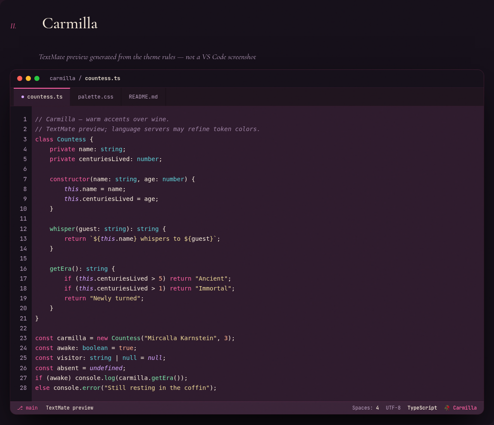
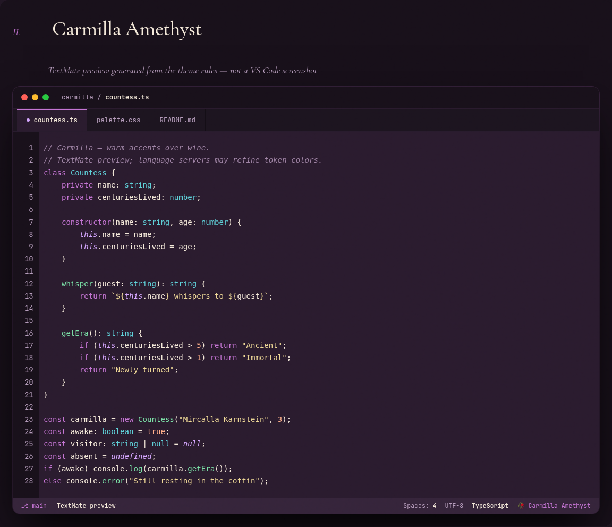
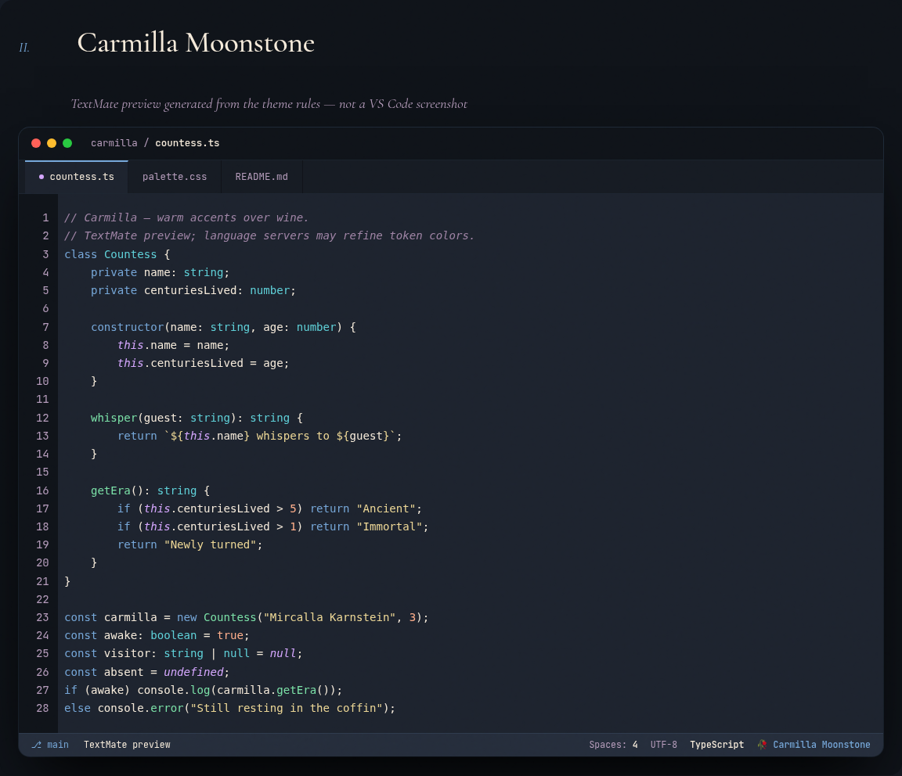

<p align="center">
  
</p>
<h1 align="center">Carmilla</h1>
<p align="center"><em>Crypt warmth for nights of code.</em></p>
<p align="center">
  A dark theme family for VS Code: cream text, mauve comments, and a choice of wine, violet or slate-blue backgrounds.
</p>
<p align="center">
  <a href="https://marketplace.visualstudio.com/items?itemName=muowl.carmilla">Install from the Marketplace</a> ·
  <a href="https://muowl.dev/themes/carmilla/">Explore Carmilla</a> ·
  <a href="CHANGELOG.md">Changelog</a>
</p>

Carmilla pairs soft backgrounds with distinct colors for types, functions, strings and keywords. Each flavor changes the accent and surrounding surfaces while keeping the cream foreground and familiar syntax palette. The name pays tribute to Sheridan Le Fanu’s gothic novella *Carmilla* (1872).

## Choose your light

| Theme | Accent | Atmosphere |
|-------|--------|------------|
| **Carmilla** | Carmine `#FF5FA2` | Rosé wine by candlelight |
| **Carmilla Amethyst** | Amethyst `#C474D3` | The same room at violet dusk |
| **Carmilla Moonstone** | Moonstone `#75A6D8` | Rem-inspired sky blue over quiet slate |

**Moonstone and the Arco icon are included in source builds for the next release.** Install the VSIX built from this branch to try them before Marketplace publication.

## Install

Install **Carmilla** by **muowl** from the [VS Code Marketplace](https://marketplace.visualstudio.com/items?itemName=muowl.carmilla), or run:

```sh
code --install-extension muowl.carmilla
```

Open the command palette, run **Preferences: Color Theme**, and select a Carmilla theme.

To install the current source build, use Node.js 22 or newer and run from the repository root:

```sh
cd ports/vscode
npm ci
npm run package
```

In VS Code, run **Extensions: Install from VSIX…**, select the generated `carmilla-*.vsix` in `ports/vscode/`, then choose your theme.

## A closer look

<p align="center">
  
</p>

<details>
<summary><strong>Carmilla Amethyst</strong> — violet dusk</summary>



</details>

<details>
<summary><strong>Carmilla Moonstone</strong> — moonlit slate</summary>



</details>

These previews are generated from the theme’s TextMate rules and a pinned TypeScript grammar. Language servers can refine highlighting in VS Code. The [local showcase](docs/index.html) lets you switch between all three flavors; the [live site](https://muowl.dev/themes/carmilla/) follows its own release schedule.

## What is themed

- Editor, tabs, sidebar, command palette, suggestions, notifications and chat surfaces.
- TextMate syntax and semantic tokens, with warm comments and distinct type/function colors.
- All 16 ANSI terminal colors, Git decorations, diffs and merge highlights.
- Focus, placeholder and selection states checked for contrast in each flavor.

Carmilla is a declarative color theme with no executable extension code. The [palette specification](palette/PALETTE.md) documents color choices, measured contrast and known limitations, including Python’s shared TextMate scope for `True`, `False` and `None`.

## Develop and contribute

Colors live in [`palette/carmilla.toml`](palette/carmilla.toml); VS Code mappings live in [`ports/vscode/theme.template.json`](ports/vscode/theme.template.json). Edit those sources, then regenerate the themes. Run these commands from `ports/vscode/` after `npm ci`:

| Command | Purpose |
|---------|---------|
| `npm run generate` | Generate every theme, the packaged changelog and the showcase code sample |
| `npm test` | Check generated files, contrast, ANSI colors, grammar behavior and Moonstone’s color constraints |
| `npm run colors` | Inspect Moonstone’s OKLCH, contrast and color-vision simulation measurements |
| `npm run test:showcase` | Check browser accessibility, mobile layouts and saved preferences |
| `npm run preview` | Refresh the flavor preview images |
| `npm run brand` | Export the approved Arco artwork for the extension and browser |
| `npm run package` | Validate and build the VSIX |

For browser commands, first run `npx playwright install chromium`, or set `CHROMIUM_PATH` to an existing Chromium executable. Open `ports/vscode/` in VS Code and press **F5** to launch the Extension Development Host, then select a Carmilla theme.

Commit generated files with their sources. CI checks the themes and showcase, builds the VSIX, and verifies that the packaged changelog matches the root copy. Keep image exports together; see the [Arco asset notes](assets/brand/README.md).

VS Code is the current port. Zed, Alacritty, Chrome and GNOME Shell are planned. To propose another port, [open an issue](https://github.com/Muowl/carmilla/issues) or start from the TOML palette. Earlier Cinnabar and Larimar variants are preserved on the [`flavors`](https://github.com/Muowl/carmilla/tree/flavors) branch.

## Repository guide

| Path | Contents |
|------|----------|
| [`palette/`](palette/) | Color source, design rationale and contrast measurements |
| [`ports/vscode/`](ports/vscode/) | Extension manifest, template and generated themes |
| [`scripts/`](scripts/) · [`tests/`](tests/) | Generation, previews and validation |
| [`assets/`](assets/) | Arco artwork and flavor previews |
| [`docs/`](docs/) | Archived standalone showcase, maintained here for previews and checks |

## License

[MIT](LICENSE). Vendored development grammars retain their [upstream licenses](tests/grammars/README.md).
